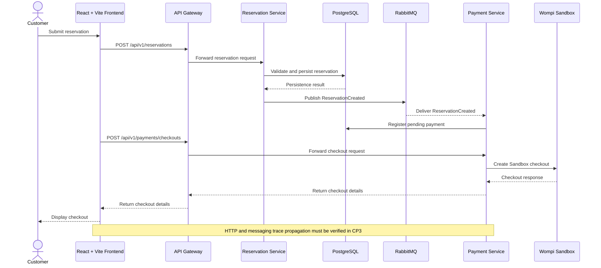

# CP1 — Critical Journey and Trace Propagation

## 1. Critical User Journey

**Journey:** Reservation creation and payment processing.

The journey starts when a customer submits a reservation request through the React + Vite frontend. The API Gateway routes the request to the Reservation Service, which validates the request and stores the reservation in PostgreSQL. The Reservation Service is expected to publish a `ReservationCreated` event through RabbitMQ. The Payment Service consumes the event and registers a pending payment.

The frontend can then request a checkout through `POST /api/v1/payments/checkouts`. The Payment Service communicates with Wompi Sandbox to initiate the checkout. Payment results, represented by `PaymentApproved` or `PaymentRejected` events in the documented design, support updating the reservation state.

This document describes the intended architecture. The actual implementation of event publication, consumption, and trace propagation must be verified during CP3.

## 2. Components Involved

| Component | Responsibility |
|---|---|
| React + Vite frontend | Submits reservation requests and presents the checkout flow. |
| API Gateway | Receives API requests and routes them to the appropriate backend service. |
| Reservation Service | Validates reservation requests and manages reservation creation. |
| PostgreSQL | Persists reservation and payment data in their respective schemas. |
| RabbitMQ | Transports domain events between services. |
| Payment Service | Registers pending payments and initiates Wompi Sandbox checkout. |
| Wompi Sandbox | Simulates the external payment provider. |

## 3. Sequence Diagram



## 4. Trace Context Propagation

The observability design must support trace context propagation across synchronous HTTP requests and asynchronous RabbitMQ messages.

### 4.1 HTTP Propagation

- Read the W3C `traceparent` header when it is present and valid.
- Establish a trace context when an incoming request does not have a valid context.
- Propagate the trace context from the API Gateway to the Reservation Service.
- Create spans for relevant service operations and downstream calls.
- Include trace identifiers in structured logs so that related operations can be investigated together.

The exact propagation behavior must be verified against the actual gateway and service implementation.

### 4.2 RabbitMQ Propagation

- Inject trace context into the headers of the `ReservationCreated` message.
- Extract the context when the Payment Service consumes the event.
- Associate the consumer operation with the originating trace, using valid parent context or span links as appropriate.
- Record failures during publication, delivery, or consumption without logging sensitive payment information.

Trace propagation must use a W3C-compatible tracing library or equivalent implementation. A new unrelated trace should not be created for every internal operation.

## 5. Expected Span Tree

The following tree illustrates the expected logical relationship between spans. Actual span names and relationships must be confirmed after instrumentation is implemented.

```text
reservation.create [API Gateway / HTTP entry]
└── reservation-service.create [HTTP server]
    ├── reservation.validate
    ├── postgres.reservation.insert
    └── rabbitmq.publish ReservationCreated
        └── payment-service.consume ReservationCreated
            └── postgres.payment.insert
```

The checkout request is a separate HTTP request and may create a separate trace. If the application needs to correlate it with the original reservation, it should use an explicit correlation strategy or supported trace links.

## 6. Failure Points

1. **Reservation persistence failure:** PostgreSQL rejects the write or is unavailable.
2. **Event publication failure:** the reservation is stored, but the event is not successfully published or delivered.
3. **Payment provider timeout:** Wompi Sandbox does not respond within the expected timeout.
4. **Payment result processing failure:** the payment result is received, but the reservation state is not updated correctly.

These failures should be investigated using trace IDs, span IDs, correlation IDs, structured logs, and service-level metrics.

## 7. Observability Outcome

The target is to follow a reservation request through the API Gateway and Reservation Service, inspect the database operation, and correlate the RabbitMQ event with the Payment Service operation.

The checkout request must also be observable. Because it is a separate HTTP request, its relationship with the original reservation must be established explicitly when necessary.

This journey provides the basis for the structured log contract, instrumentation, golden-signal metrics, SLOs, alerts, and incident response defined in the subsequent checkpoints.
