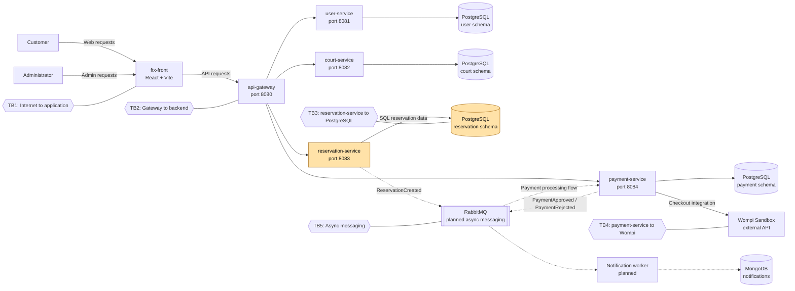

# CP1 — Attack Surface Map

## 1. System overview

Futbolix is a court reservation platform. This map identifies its main components, data flows, assets and trust boundaries. Security controls must be verified against the current implementation before they are described as active.

## 2. Data-flow diagram

Claimed boundary: TB3 — reservation-service to PostgreSQL.
3. Trust boundaries
ID	Boundary	Security concern
TB1	Customer or administrator to the application	Requests from outside the system must be validated.
TB2	API gateway to backend services	Only permitted operations should reach each service.
TB3	reservation-service to PostgreSQL	Reservation records must be protected from unauthorized reading or modification.
TB4	payment-service to Wompi Sandbox	Checkout requests and payment results must be validated.
TB5	Services to the messaging system	Events must be protected against unauthorized publication or consumption.

4. Asset inventory
Asset	Location	Classification	Reason
Reservation details and status	reservation-service and its PostgreSQL schema	Confidential	Unauthorized changes could affect reservations.
Reservation lookup code	Reservation records	Confidential	It must not expose reservation information to unauthorized callers.
Administrator JWT	Admin client and authenticated requests	Restricted	It grants access to privileged operations.
Payment status and transaction references	payment-service and its PostgreSQL schema	Confidential	They affect the recorded payment result.
Wompi credentials	payment-service configuration or environment	Restricted	Credentials must not be exposed in code or logs.
Court and schedule availability	court-service and its PostgreSQL schema	Internal	It supports court availability and reservation decisions.
Notification data	MongoDB notification storage	Confidential	Notifications may contain reservation-related information.

5. Entry points for the selected boundary
Entry point	Caller	Authentication or control to verify
API gateway, port 8080	Frontend or external client	Verify public routes, authentication and request validation in the current gateway configuration.
POST /api/v1/reservations	Client through the API gateway	Verify validation, permitted access and how reservation data is handled.
Public reservation lookup by code	Customer	Confirm the exact route and verify that only the intended reservation information is returned.
Database connection from reservation-service	reservation-service	Verify database credentials, schema permissions and network access.

The exact public lookup route and the current authentication rules must be confirmed in the team API contract and implementation. This map does not assume that an unverified control already exists.
6. Security observations
- The selected boundary protects reservation data between reservation-service and PostgreSQL.
- The database account should have only the permissions required by the reservation service. Verify the real configuration before stating that this is enforced.
- The project uses Wompi Sandbox for payment integration.
- RabbitMQ is part of the planned asynchronous flow. Confirm which messaging components are implemented before treating that flow as active.
- The team architecture includes MongoDB for notifications. Verify the current deployment and worker before describing them as running.
- The next step is to analyze this boundary with STRIDE and prioritize its risks.